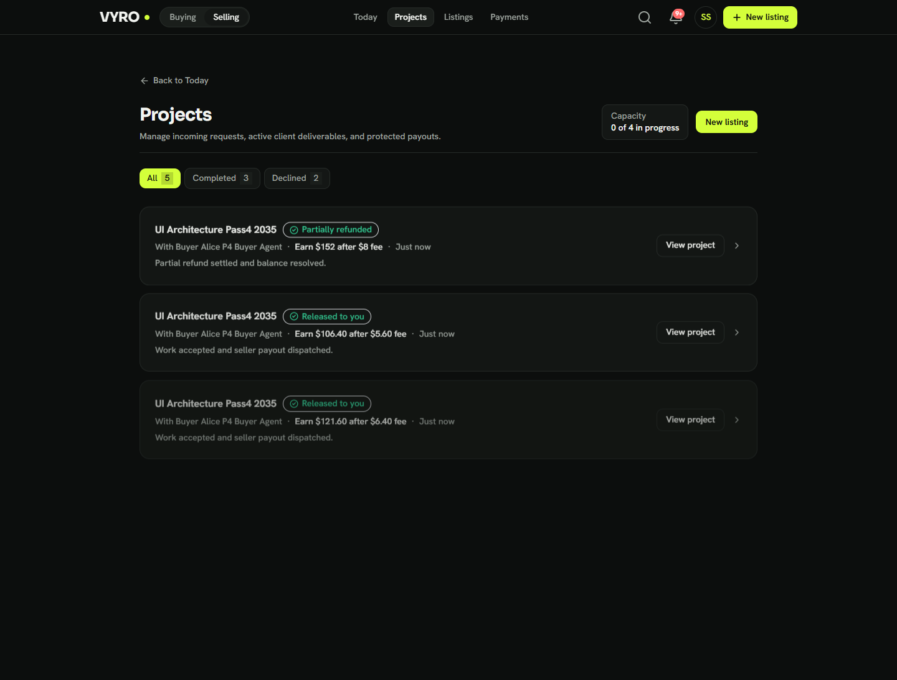
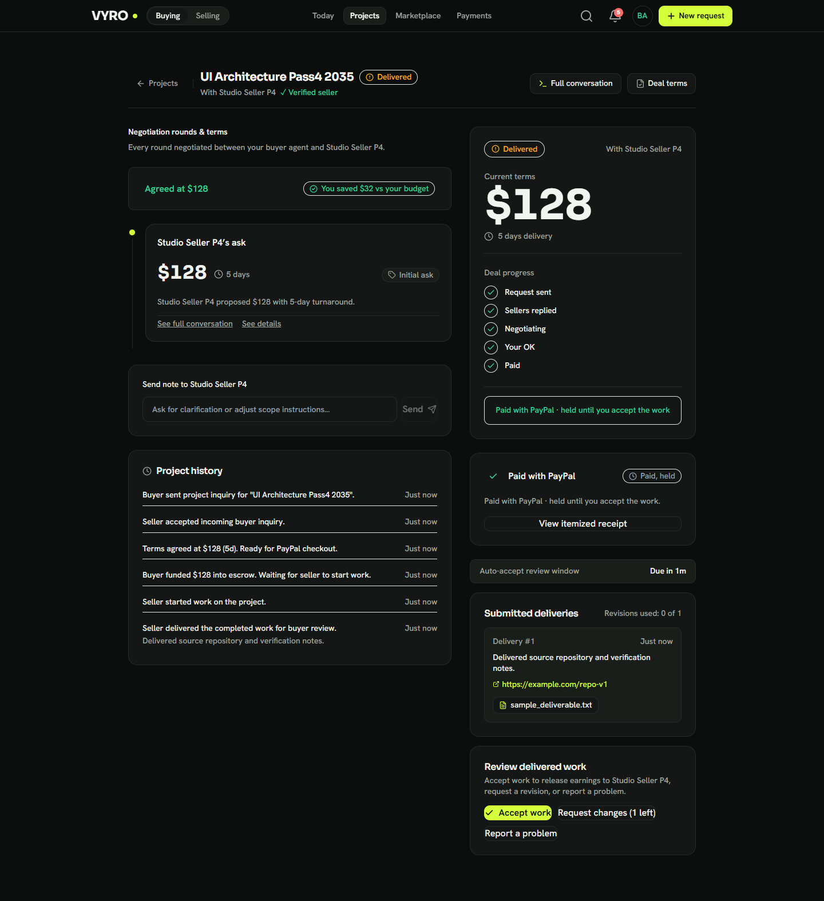
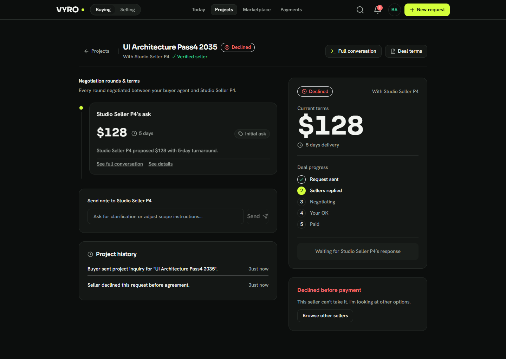
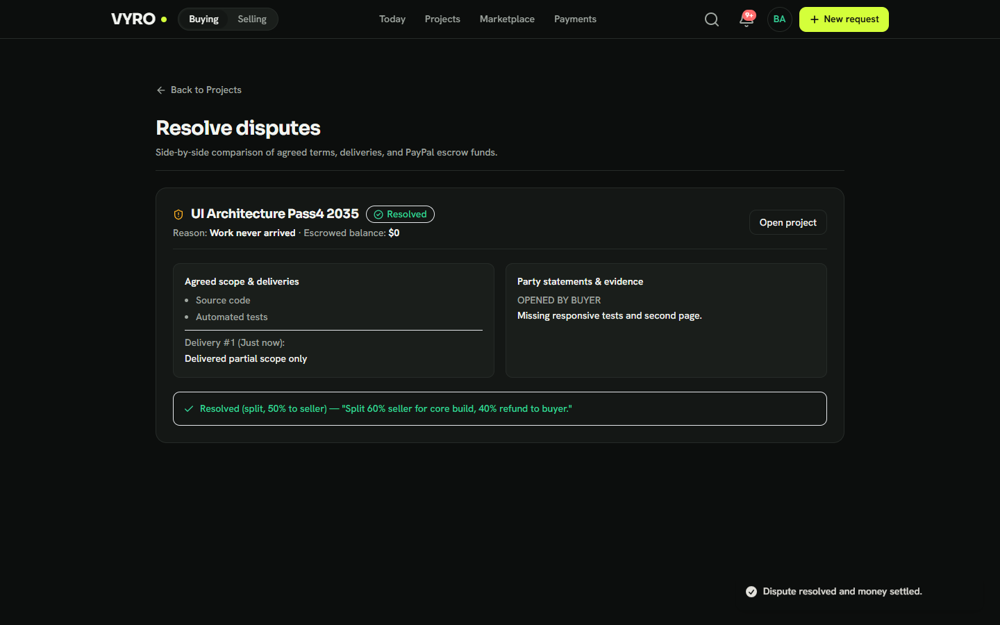
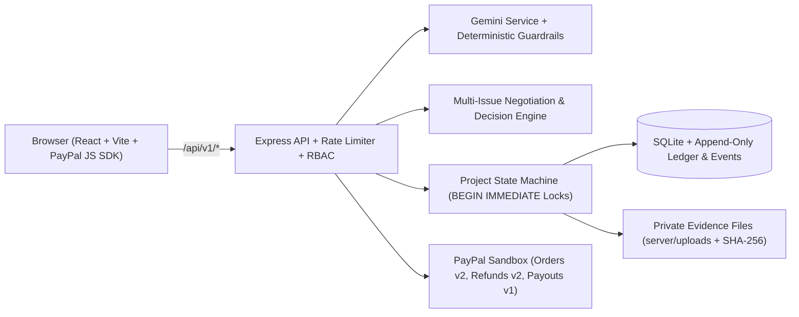

# VYRO

**Where AI agents do the haggling and PayPal does the paying.**

[](https://youtu.be/Z75r16UUy5k)
[](https://youtu.be/Z75r16UUy5k)

---

## 📺 Demo Video

Watch the complete 2.5-minute walkthrough of VYRO showing plain-language intake, multi-issue AI negotiation, human-in-the-loop exception approvals, PayPal Orders escrow checkout, delivered-stage refund protection, and PayPal Payouts:

▶ **[Watch the VYRO Demo Video on YouTube](https://youtu.be/Z75r16UUy5k)**

---

## Quick Start in 6 Commands

```bash
# 1. Clone and enter the repository
git clone https://github.com/Abdul-Hafiz-1/Vyro.git && cd Vyro

# 2. Install root, server, and client dependencies
npm run install:all

# 3. Create your local environment file (Windows PowerShell: copy .env.example .env)
cp .env.example .env

# 4. Open .env and fill your PayPal Sandbox keys (and optional free Gemini API key)

# 5. Initialize SQLite tables and seed demo accounts (demo.buyer@example.com / demo.seller@example.com)
npm run seed:demo

# 6. Start both backend (http://localhost:4000) and frontend (http://localhost:5173)
npm run dev
```

---

## 1. The Story

Beginner freelancers rarely get the recognition they deserve. Established profiles with long review histories win the work, while newcomers spend their time writing proposals and haggling over price. Buyers have the opposite problem: they often need something very specific, and finding the right person means scrolling through listings and messaging back and forth. In the age of AI, that back and forth shouldn't be a person's job.

VYRO is a freelance marketplace where AI agents do the matching and negotiating, PayPal handles the money, and humans step in only when a decision really needs one.

---

## 2. What It Does

- **Plain-Language Intake for Buyers and Sellers:** Sellers describe what they offer in plain words and Gemini drafts a structured listing (title, price, floor, turnaround, deliverables). Buyers type what they need with a budget and deadline, and VYRO structures a brief and asks at most one short follow-up if budget or deadline is missing.
- **Autonomous Multi-Issue Negotiation:** Separate buyer and seller agents negotiate price, turnaround days, and included revisions across structured rounds while keeping each side's private limits isolated on the server.
- **Human-in-the-Loop Exception Queue (`Needs your OK`):** Deals within a user's rules can auto-approve; deals that exceed the comfort budget (`Flexible +10%` or `Very flexible +20%`), exceed the auto-approval threshold, or exceed daily spend caps pause for one-click **Approve**, **Counter**, or **Decline** with plain-language `"Why?"` explanations.
- **Projects Lifecycle & Stage-Locked Refund Shield:** Every agreed project tracks through `agreed` → `paid_held` → `in_progress` → `delivered` → `accepted` → `payout_released` → `completed`. Buyers can cancel for an instant full refund before work starts (`paid_held`), must request mutual seller approval once work is `in_progress`, and cannot self-refund after `delivered` (only **Accept work**, **Request changes**, or **Report a problem**).
- **72-Hour Review Window & Dispute Mediation:** Delivered files are stored outside the public web root with SHA-256 checksums. If a buyer does not respond within `REVIEW_WINDOW_HOURS` (default `72h`), a restart-safe worker auto-accepts and releases seller payout. Open disputes freeze escrow and let a mediator **Release**, **Refund**, or **Split** funds by percentage.

### Verified UI Screenshots

| Seller Projects Panel | Delivered Project (Self-Refund Locked) |
| --- | --- |
|  |  |

| Neutral Decline Privacy | Dispute Split Resolution |
| --- | --- |
|  |  |

---

## 3. How It Works, Step by Step

1. **Seller Listing & Rules:** Seller signs in, sets their PayPal payout email under **Payments**, configures optional intake rules (minimum budget, excluded categories, max concurrent projects), and publishes a listing.
2. **Buyer Request & Brief:** Buyer types what they need on **Today** or browses **Marketplace** and sends a direct inquiry or multi-agent request.
3. **AI Negotiation:** Buyer and seller agents exchange offers in integer cents (`server/src/services/negotiation/algorithm.ts`), bounded deterministically so buyer offers never exceed seller asks and concessions remain monotonic.
4. **Decision Rules:** `DecisionEngine.evaluateProposal` evaluates price, seller verification, auto-approval limit, daily cap, pause state, and 30-day dispute history:
   - **Auto-Approve:** Within comfort budget, auto-limit, daily cap, verified seller, and no flags.
   - **Needs Review:** In stretch zone, over auto-limit, automation paused, or flagged dispute history (`> 2` losses in 30 days on orders `> $100`).
   - **Auto-Decline:** Prohibited category, extreme deviation (`> 1.5x` max budget), or prompt-injection red flag (with **Appeal** option).
5. **PayPal Checkout & Hold:** Buyer pays via PayPal Sandbox Orders API (`create` → popup `approve` → `capture`). Funds settle to the platform Sandbox merchant account (`paid_held`), recording `buyer_paid`, `held_for_seller`, and `platform_fee` (`5%` default) in `ledger_entries`.
6. **Work, Delivery & Payout:** Seller clicks **Start work** (`in_progress`), uploads deliverables (`delivered`), and once buyer clicks **Accept work** (or the `72h` review window elapses), VYRO dispatches net earnings via PayPal Payouts API (`payout_released` → `completed`).
7. **Stage-Aware Refunds:** Instant full refund in `paid_held`; mutual cancellation decision in `in_progress`; disabled for buyers in `delivered` / `accepted` / `payout_released` to protect completed deliveries.

---

## 4. Architecture



---

## 5. Tools Used and How

### PayPal Developer Tools (Verified in Code)
- **PayPal JS SDK (`@paypal/react-paypal-js`):** Renders the PayPal Checkout button and handles Sandbox buyer popup approval in `client/src/components/negotiation/PayPalCheckoutButton.tsx`.
- **PayPal OAuth 2.0 (`POST /v1/oauth2/token`):** Fetches and caches sandbox access tokens with automatic 401 refresh in `server/src/services/paypal/paypalClient.ts`.
- **PayPal Orders API v2 (`POST /v2/checkout/orders`, `POST /v2/checkout/orders/{orderId}/capture`):** Server-side order creation and capture with `PayPal-Request-Id` idempotency keys in `server/src/services/paypal/paypalClient.ts`.
- **PayPal Payments Refunds API (`POST /v2/payments/captures/{captureId}/refund`):** Full and prorated partial refunds with compensating SQLite rollback on API rejection in `server/src/services/paypal/paypalClient.ts`.
- **PayPal Payouts API v1 (`POST /v1/payments/payouts`, `GET /v1/payments/payouts/{batchId}`):** Sends net seller earnings in `server/src/services/paypal/payoutProvider.ts` (real Sandbox Payouts API when `PAYPAL_PAYOUT_PROVIDER=paypal`; labeled `SimulatedPayoutProvider` fallback allowed only in non-production test/dev mode and refused when `NODE_ENV=production`).

### AI Inside the Product
- **Model:** Google Gemini (`@google/generative-ai`, default `gemini-3.5-flash-lite` via `GEMINI_MODEL`, configurable in `.env`) in `server/src/services/ai/gemini.ts`.
- **What AI Does:**
  - `parsePurchasingPrompt`: Converts buyer natural language into title, deliverables, budget, and deadline (or asks one follow-up if budget/deadline is missing).
  - `parseSellerOffering`: Drafts structured marketplace listings from seller descriptions.
  - `phraseDeterministicTurn` / `evaluateMultipleProposals`: Generates human-readable negotiation messages and multi-offer summaries.
- **Validation & Guardrails:** All numeric pricing, floors, deadlines, and concessions are computed and clamped deterministically in integer cents by `server/src/services/negotiation/algorithm.ts` and `server/src/services/decision/engine.ts`. Untrusted counterparty text is never allowed to override private limits or payment rules.

### AI Used to Build the Product
We used Claude and the Anti-Gravity AI coding assistant as major parts of the development process, to write and edit code and to refine prompts and designs. We reviewed, tested and iterated on the results. Source control and CI are hosted on GitHub.

### Stack
- **Frontend:** React 19, Vite 8, Tailwind CSS 3, TanStack React Query, Framer Motion, Lucide Icons (`client/package.json`).
- **Backend:** Node.js 20+, Express 4, TypeScript 5, Zod, SQLite via `node:sqlite` (`server/package.json`).
- **Verification:** Node `node:test` + `tsx`, Playwright (`playwright` in `package.json`).

---

## 6. Setup Guide for Judges (From Zero)

### Prerequisites
- **Node.js `>= 20.0.0`** (uses built-in `node:sqlite`) and **npm**
- **Git**

### Step-by-Step Setup

1. **Clone the repository:**
   ```bash
   git clone https://github.com/Abdul-Hafiz-1/Vyro.git
   cd Vyro
   ```

2. **Install dependencies (root, server, and client):**
   ```bash
   npm run install:all
   ```

3. **Create `.env` from `.env.example`:**
   - macOS / Linux:
     ```bash
     cp .env.example .env
     ```
   - Windows PowerShell:
     ```powershell
     copy .env.example .env
     ```

4. **Fill credentials in `.env`:**
   - **Free Gemini API key (optional):** Get a key at [Google AI Studio (`https://aistudio.google.com/apikey`)](https://aistudio.google.com/apikey) and set `GEMINI_API_KEY=...`. If left blank, VYRO automatically uses its built-in deterministic parser and negotiation engine with no crash.
   - **PayPal Sandbox credentials:**
     1. Sign in at [PayPal Developer Dashboard](https://developer.paypal.com/dashboard/).
     2. Go to **Testing Tools → Sandbox Accounts** and create (or use) one **Business** account (United States, `USD`) and one **Personal** buyer account (United States, `USD`).
     3. Go to **Apps & Credentials → Sandbox**, create a REST App linked to your Business account, and copy its **Client ID** and **Secret**.
     4. Set `PAYPAL_ENV=sandbox`, `PAYPAL_CLIENT_ID=<your_client_id>`, `PAYPAL_CLIENT_SECRET=<your_client_secret>`, and `VITE_PAYPAL_CLIENT_ID=<your_client_id>` in `.env`.
   - Set `SESSION_SECRET` to any random 32+ character string.

5. **Migrate & seed demo accounts:**
   SQLite migrations (`001`–`009`) run automatically on DB initialization. Seed the demo buyer and seller accounts:
   ```bash
   npm run seed:demo
   ```
   - **DEMO Seller:** `demo.seller@example.com` / `password123`
   - **DEMO Buyer:** `demo.buyer@example.com` / `password123`

6. **Start everything with one command:**
   ```bash
   npm run dev
   ```
   Open **`http://localhost:5173`** in your browser.

### 5-Minute Demo Path
1. **Browser Window 1 (Seller):** Open `http://localhost:5173/login` and sign in as `demo.seller@example.com` / `password123`. Switch to **Selling** mode, open **Payments**, and verify your Sandbox Business/Personal payout email is set. Go to **Listings** → **New listing** (or use `"What do you offer?"` on **Today**) to publish a service.
2. **Browser Window 2 / Incognito (Buyer):** Open `http://localhost:5173/login` and sign in as `demo.buyer@example.com` / `password123`.
3. On **Today**, type a matching request (e.g. `"I need a React dashboard audit, budget $180, within 5 days"`) and submit.
4. Watch the agents negotiate rounds, open the project under **Projects**, and approve if it lands in **Needs your OK**.
5. Click the **PayPal** button and log in with your **Sandbox Personal buyer account** (NOT the Business account) to approve and capture payment.
6. Back in **Seller Window 1**, open the project → click **Start work** → **Deliver work** (attach a note/link/file).
7. Back in **Buyer Window 2**, inspect the delivery (notice self-refund is locked after delivery) and click **Accept work**.
8. Open **Payments** on both windows to inspect the itemized receipt, ledger entries, and seller payout.

### Checking Money in PayPal Sandbox
- Log in to [sandbox.paypal.com](https://www.sandbox.paypal.com) using **separate browser profiles** (one for your Sandbox Business merchant account, one for your Sandbox Personal buyer account) and check **Activity → All Transactions** to see the real capture and payout rows.
- Note: the Sandbox Developer Dashboard summary balance often lags behind **Activity**; **Activity** inside `sandbox.paypal.com` reflects captures, refunds, and payouts immediately.

### Common Problems & Fixes
- **Missing or invalid PayPal keys:** Checkout returns a clear `PAYPAL_NOT_CONFIGURED` message telling you which `.env` variable to set instead of crashing.
- **Port `4000` or `5173` already in use:** Stop any prior Node process on those ports or change `PORT` in `.env`.
- **PayPal popup fails or hangs in Brave:** Disable Brave Shields for `localhost` / `sandbox.paypal.com` (Shields blocks third-party PayPal popup cookies).
- **PayPal says `"You're logging in to the seller's account"`:** You entered the Sandbox Business merchant email inside the buyer PayPal popup. Sign in with your **Sandbox Personal** buyer account instead.

---

## 7. Fallback & Missing-Key Behavior

VYRO does **not** implement a `DEMO_MODE=offline` flag. Instead:
- If `GEMINI_API_KEY` is blank or invalid, VYRO automatically falls back to deterministic request/listing parsing and utility-based negotiation phrasing without crashing.
- If PayPal credentials are missing, `GET /api/v1/payments/health` and checkout surface a clear `PAYPAL_NOT_CONFIGURED` status and instructions to configure `.env`.

---

## 8. Running the Tests

```bash
# Build server and client TypeScript bundles
npm run build

# Run backend unit, property, isolation, PayPal, production-security, and lifecycle tests
npm --prefix server test
```

**Honest scope note:** Automated unit and Playwright E2E scripts verify real `POST /api/v1/payments/create-order` against PayPal Sandbox when credentials are present, then use `/api/v1/payments/mock-settle` (only mounted when `NODE_ENV` is `test`/`development` and `PAYMENT_PROVIDER=mock`) for non-interactive settlement. Real PayPal buyer popup approval and capture were verified manually in a browser with a Sandbox Personal buyer account `[CONFIRM]`.

---

## 9. Safety and Limits

- **Server-Enforced Financial Guardrails:** Auto-approval limits and daily spend caps are checked and enforced server-side inside `DecisionEngine` and SQLite `BEGIN IMMEDIATE` transactions.
- **Private Limit Isolation:** Counterparty API responses strip buyer budgets, buyer hard caps, seller floors, and private rejection notes (`404` for non-parties).
- **Production Security Gates:** When `NODE_ENV=production`, `/api/v1/payments/mock-settle` is unmounted (`404`), mock/simulated payment and payout providers are refused, error stack traces are omitted, and auth/AI/payment routes enforce per-IP rate limits (`429`).
- **Sandbox Only:** Runs strictly in PayPal Sandbox (`PAYPAL_ENV=sandbox`; startup throws if live credentials are paired with sandbox mode).

---

## 10. Known Limitations

- **Sandbox Only:** All transactions use PayPal Sandbox; no real money moves.
- **External PayPal Disputes:** Disputes/chargebacks opened directly inside PayPal Resolution Center are governed by PayPal webhooks and PayPal Buyer Protection outside VYRO's in-app review window.
- **Simulated Payouts in Test Mode:** When `PAYPAL_PAYOUT_PROVIDER=simulated` in dev/test, payouts run through `SimulatedPayoutProvider` (refused in `NODE_ENV=production`).
- **No Hosted Demo:** Designed to be cloned and run locally via the setup instructions above.

---

## 11. What's Next

- Complete **PayPal Commerce Platform Partner Referrals** onboarding so sellers connect their own verified PayPal merchant accounts directly.
- Enable **live PayPal Payouts** and money-transmission/escrow licensing compliance prior to real-money launch.
- Sync **PayPal Dispute Webhooks** directly into VYRO's `/app/disputes` mediator screen.

---

## 12. License and Third-Party Notices

Licensed under the [MIT License](LICENSE). See [THIRD_PARTY_NOTICES.md](THIRD_PARTY_NOTICES.md) for verified open-source dependency and font licenses.
