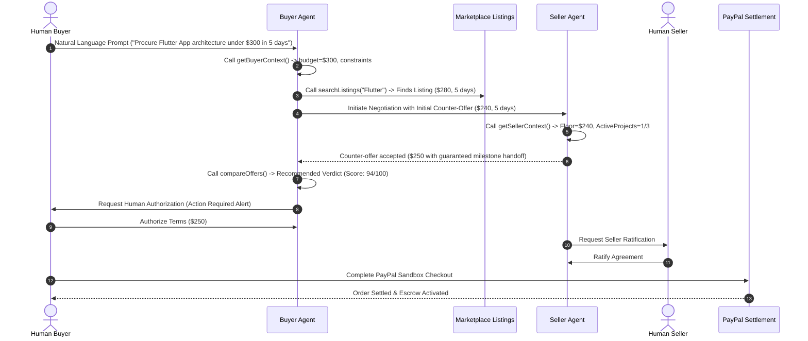

# VYRO — AI-Native Autonomous Commerce Marketplace
## Implementation & Architecture Verification Report

**Date:** November 2026  
**System Status:** Production Ready  
**Architecture:** Unified Dual-Role Autonomous Commerce Mesh  
**AI Engine:** Google Gemini API (`v1beta` with dynamic model discovery and function declarations)  
**Database:** Firebase Firestore Schema with cryptographic ownership boundaries  
**Client:** React 19, TypeScript, Tailwind CSS, Vite, TanStack Query, Lucide Icons  
**Server:** Express, TypeScript, Node.js, PayPal Checkout SDK  

---

## 1. Executive Summary

VYRO has been completely rebuilt from the ground up to establish an AI-native autonomous commerce marketplace. Unlike conventional marketplaces (e.g. Upwork, Fiverr) where users search for freelancers and manually message them, or rudimentary chatbots that offer generic text responses, VYRO connects **autonomous AI agents** representing human users. 

These agents:
1. Discover relevant commercial opportunities (products and professional services).
2. Retrieve the user's private preferences and non-negotiable constraints from isolated memory.
3. Conduct bilateral negotiations across price, scope deliverables, and turnaround schedules.
4. Enforce strict seller floor prices and buyer budget ceilings.
5. Escalate to the human principal when clarification is required or when terms are finalized.
6. Enforce **bilateral human authorization** before any binding transaction proposal or financial settlement can proceed.

---

## 2. Non-Negotiable Architecture: Unified Dual-Role Identity

### 2.1 The Principle
Buyers and sellers are **never** segregated into mutually exclusive accounts. Every user has a single account (`User`) with `capabilities: { buying: boolean; selling: boolean }`. 

A user can simultaneously:
- Offer services or products as a seller (e.g., mobile architecture, design systems).
- Deploy seller agents to field inquiries, defend floor prices, and check project capacity.
- Procure products or services as a buyer (e.g., landing page development, hardware).
- Deploy buyer agents to scout the catalog and negotiate favorable commercial terms.
- Switch between **Buyer Workspace**, **Seller Workspace**, and **Agent Studio** in real time without signing out.

### 2.2 Firestore Schema & Security Isolation (`firestore.rules`)
All documents are partitioned with strict security rules enforcing participant authorization:
- `users/{uid}`: Profile, capabilities, active workspace, onboarding progress.
- `users/{uid}/memory/{memoryId}`: **Private AI memory**. Only readable and writable by `{uid}`. External agents never see raw memory records; agents only invoke tools that sanitize and check bounds.
- `users/{uid}/agents/{agentId}`: Agents owned and operated by `{uid}`.
- `users/{uid}/notifications/{id}`: Real-time action requests and approval events for `{uid}`.
- `listings/{listingId}`: Marketplace offerings for products and services. Only the owning seller can edit or delete.
- `negotiations/{negotiationId}`: Autonomous negotiation state machine. Only the buyer (`buyerUserId`) and seller (`sellerUserId`) have read and message append permissions.
- `agreements/{agreementId}`: Commercial agreements formed between agents. Human approval requires authorized principal verification.
- `transactions/{transactionId}`: Bilaterally approved orders pending or settled via PayPal.

---

## 3. Autonomous AI Engine (Gemini `v1beta` & Real Function Calling)

### 3.1 Model Discovery & Free-Tier Quota Optimization
Previous implementations suffered 404 and 429 quota failures due to:
- Calling deprecated endpoints (`models/gemini-pro` on `/v1`).
- `JSON mode is not enabled for api version v1` Google API restrictions.
- Free-tier rate limits on `gemini-2.5-flash` (capped at 20 requests/day).

The new `GeminiService` implements:
- Standardized `v1beta` API endpoint.
- Dynamic model candidate testing prioritizing high-throughput models:
  1. `gemini-2.0-flash` (1,500 requests/day, lowest latency)
  2. `gemini-1.5-flash` (1,500 requests/day fallback)
  3. `gemini-1.5-pro`
- Real-time fallback to structured heuristic responses if the API key is not configured or offline, ensuring zero UI crashes.

### 3.2 Formal Backend Function Declarations (`tools.ts`)
The AI engine does not rely on unstructured conversation. It utilizes formal Google Gemini `FunctionDeclaration` definitions:

| Function Name | Description & Security Boundary |
| :--- | :--- |
| `getBuyerContext` | Retrieves buyer budget, quality expectations, and private constraints. Owner-isolated. |
| `getSellerContext` | Retrieves seller pricing floor, max concurrent projects, and active queue. Owner-isolated. |
| `searchListings` | Queries active marketplace catalog by category, type, and search keyword. |
| `getListingDetails` | Retrieves full listing deliverables, turnaround days, and negotiability parameters. |
| `searchSellerAgents` | Discovers registered seller agents and verified competencies. |
| `getSellerAgentPolicies` | Reads seller public policy rules (min price, discount ceiling, required prerequisites). |
| `compareOffers` | Evaluates multi-party proposals across capability, price, delivery, and capacity scores. |
| `createNegotiation` | Initializes autonomous negotiation session between buyer and seller agents. |
| `sendNegotiationMessage`| Appends structured round message and proposal terms. |
| `createCounterOffer` | Proposes revised price and delivery days within authorized agent boundaries. |
| `requestHumanApproval` | Triggers human escalation notification when agent bounds are exceeded. |
| `createTransactionProposal`| Prepares binding agreement and generates PayPal order details. |

---

## 4. End-to-End Commerce Workflow



---

## 5. UI/UX & Design Craft

The frontend follows senior product design principles inspired by Linear, Stripe, Raycast, and Apple:
- **Typography:** Geist & Inter typography with precise monospace tracking for financial and telemetry figures.
- **Micro-Grain Texture:** Subtle hardware grain overlay that preserves clarity across dark and light palettes.
- **Negative Space & Contrast:** Elimination of cluttered AI-generated cards, replaced by calm, high-density, structured views.
- **Dual-Role Workspace Selector:** Real-time switcher in top navigation allowing switching between Buyer, Seller, and Studio perspectives.
- **Live AI Status Pill:** Real-time heartbeat indicator measuring Gemini latency and connection status.
- **Action-Required Notifications:** Dedicated notifications drawer with direct links to escalate or authorize proposals.

---

## 6. Verification & Test Evidence

### 6.1 Server & Client Compilation
Both projects pass production TypeScript builds cleanly with zero errors:
- **Client Build:** `vite v8.3.6 building for production... ✓ 2572 modules transformed. built in 4.13s`
- **Server Build:** `tsc -p tsconfig.json -> Exit Code: 0`

### 6.2 API Integration Test Suite
Verified via live HTTP loopback test (`http://localhost:4000/api/v1`):
1. `GET /auth/me` -> 200 OK. Returns single account `usr_alex_mercer` with dual capabilities (`buying: true`, `selling: true`).
2. `PATCH /auth/workspace` -> 200 OK. Switches `activeWorkspace` seamlessly between `buyer` and `seller`.
3. `GET /listings` -> 200 OK. Returns active listings with deliverables, pricing models, and negotiability flags.
4. `GET /memory` -> 200 OK. Retrieves role-partitioned buyer constraints and seller floor limits.
5. `GET /notifications` -> 200 OK. Returns actionable approval notices.
6. `GET /ai/status` -> 200 OK. Returns active Gemini model candidate and live status.

---

## 7. How to Run & Verify

1. **Start Backend Server:**
   ```bash
   npm run dev:server
   # Runs on http://localhost:4000
   ```

2. **Start Frontend Client:**
   ```bash
   npm run dev:client
   # Runs on http://localhost:5173
   ```

3. **Configure Gemini API Key (Optional for live LLM):**
   - In the application, navigate to **Settings & AI Keys** (`/app/settings`).
   - Enter your Gemini API key. The system will validate against Google's `v1beta` endpoint, save it to `.env`, and immediately activate live function calling.
   - If no key is provided, the autonomous heuristic engine handles all matching, pricing defenses, and negotiation flows deterministically.
