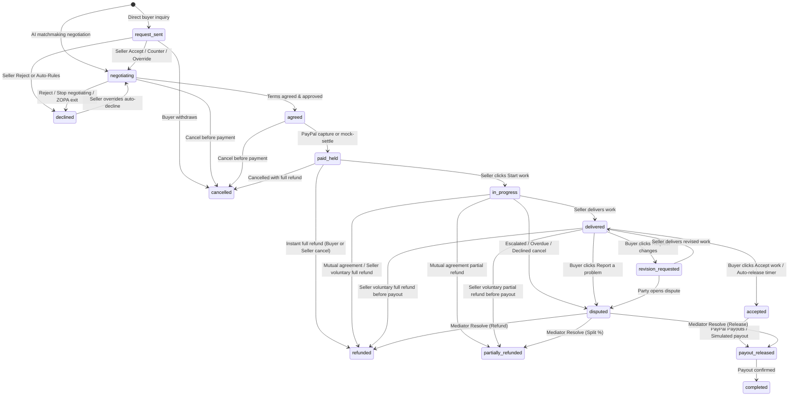

# Projects Lifecycle, Reject/Cancel, Refund Fail-Safe & Disputes Audit

**Branch:** `feature/projects-reject-refunds`

---

## 1. Project State Machine (`project_status`)

Single source of truth stored on `negotiations.project_status`, enforced exclusively by [`ProjectStateMachineService`](file:///c:/Users/User/Desktop/My_Apps/VYRO/server/src/services/projects/projectStateMachine.ts) with an append-only audit trail in `project_events` (`deal_id`, `actor_user_id`, `actor_role`, `from_status`, `to_status`, `summary`, `reason`, `metadata`, `created_at`). Every transition runs inside SQLite `BEGIN IMMEDIATE` (`store.runInImmediateTransaction`) and returns `404` for non-parties or `409` for disallowed roles/stages.

---

## 2. Summary of Delivered Phases

### Phase 1 — Projects Panel, Reject/Cancel & Refund Fail-Safe
- **Schema & Persistence (`server/src/db/sqlite.ts`, `server/src/db/store.ts`)**: Migration `009_projects_state_reject_refunds_disputes` adds `project_status`, delivery/review/due timestamps, revision counters, reject reason privacy columns (`reject_reason`, `shared_reject_note`), `seller_auto_rules` & `user_role` on `users`, `idempotency_key` unique index on `ledger_entries`, and new tables `project_events`, `deliveries`, `cancellation_requests`, and `disputes`.
- **Navigation & Projects Panel (`AppLayout.tsx`, `App.tsx`, `NegotiationsListPage.tsx`, `OverviewPage.tsx`)**:
  - Top tabs updated to `Today · Projects · Marketplace · Payments` (Buying) and `Today · Projects · Listings · Payments` (Selling), keeping `/app/deals*` redirects to `/app/projects*`.
  - Seller Projects view displays concurrent capacity meter (`"X of Y in progress"`, `"At capacity"` badge when full), role-specific stage filter tabs with live counts, due-window countdowns, integer-cents net earnings preview, and Seller Today `"Your projects"` summary + incoming requests inbox.
- **Reject, Pause & Auto-Rules (`ListingsPage.tsx`, `MemoryPage.tsx`, `projectStateMachine.ts`)**:
  - Seller `Accept`, `Counter`, and `Reject` popover with reason chips and opt-in `shareNote`. When unchecked, buyers see only `"This seller can't take it. I'm looking at other options."` and both `negotiations` and `project_events` sanitize private seller reasons from buyer responses.
  - Listing Pause/Resume (`PATCH /api/v1/listings/:id/pause`), Seller capacity hiding during autonomous matching, and Seller Intake Auto-Rules (`PATCH /api/v1/projects/seller/rules`: min budget, excluded categories, min deadline days, auto-reject at capacity, manual inbox toggle) with `Override auto-decline`.
- **Stage-Locked Refund Fail-Safe (`paypalClient.ts`, `ProjectStagePanel.tsx`)**:
  - `paid_held`: Buyer and seller can cancel for an immediate full refund (with confirmation modal).
  - `in_progress`: Buyer instant refund is blocked (`409 REFUND_REQUIRES_SELLER_APPROVAL`); buyer submits a mutual cancellation request for Seller decision (`Agree full`, `Agree partial`, or `Decline`).
  - `delivered` / `revision_requested`: Buyer self-refund is blocked (`409 REFUND_BLOCKED_AFTER_DELIVERY`) and zero refund buttons render in UI — only `Accept work`, `Request changes`, and `Report a problem`.
  - `accepted` / `payout_released`: Blocked once payout is approved (`409 PAYOUT_ALREADY_APPROVED`); sellers are shown instructions to issue post-payout refunds directly via PayPal.

### Phase 2 — Delivery Evidence, Revisions & Review Window Auto-Release
- **Private Evidence Storage (`server/src/services/projects/fileEvidence.ts`)**: Allowlisted file extensions (`.pdf`, `.png`, `.jpg`, `.jpeg`, `.webp`, `.zip`, `.txt`, `.md`, `.json`, `.csv`, `<= 10 MB`) are stored under `server/uploads` (outside web root) with SHA-256 digests and served exclusively to project parties/admins via `GET /api/v1/projects/:id/files/:fileId` (`404` for third parties).
- **Revisions & Reminders (`ProjectStagePanel.tsx`, `projectStateMachine.ts`)**: Enforces `revisionsUsed < revisionsAllowed` (`1` default), transitions `delivered -> revision_requested -> delivered`, supports rate-limited `"Send reminder"`, and exposes overdue `"Seller is late"` buyer actions.
- **Restart-Safe Review Window (`reviewWindowWorker.ts`)**: Computes `review_due_at` from configurable `REVIEW_WINDOW_HOURS` (default `72`, supports short decimal values such as `0.001` = 3.6s) and polls SQLite on startup + 60s interval to idempotently auto-accept and release payout unless disputed.

### Phase 3 — Disputes & Mediator Resolution
- **Disputes Flow (`disputeService.ts`, `DisputesResolvePage.tsx`)**: Parties can open disputes from allowed stages with reason chips, links, and SHA-256 files; respondents get a `DISPUTE_RESPONSE_HOURS` (default `72h`) reply window; `/app/disputes` renders agreed deliverables vs delivery evidence side-by-side and supports `Release`, `Refund`, or percentage `Split` resolution in integer cents.
- **Abuse Flag (`engine.ts`, `disputeService.ts`)**: Rolling 30-day dispute losses `> 2` surface abuse indicators on disputes and block auto-approval for orders `> $100`, routing them to human review.

---

## 3. Money Invariants, Concurrency Locks & Idempotency

All money math uses integer cents (`computeFeeAndPayoutCents`, `computeRefundBreakdown`):
- **Invariant**: Every refund and payout executes its pre-check and ledger/state reservation inside SQLite `BEGIN IMMEDIATE`:
  $$\text{refunded\_cents} + \text{paid\_out\_cents} \le \text{captured\_cents}$$
- **Prorated Fee Refund**: Full refunds return the full captured platform fee (`platform_fee_refund`); partial refunds prorate `platform_fee_refund` proportionally so net accounting balances cleanly.
- **Atomic Race Protection**: `acceptWorkAndReleasePayout` reserves a `payout` row in `scheduled` status inside `BEGIN IMMEDIATE` before invoking external PayPal Payouts, and `refundPayment` checks both ledger totals and `payout.status` under the same write lock, guaranteeing concurrent `accept-work` and `refund` requests cannot double-spend.
- **PayPal Failure Rollback**: Live PayPal `/v2/payments/captures/{id}/refund` HTTP errors trigger compensating SQLite rollback of transaction/agreement/project status and remove provisional refund ledger rows.

---

## 4. Verification & Evidence

1. **TypeScript & Vite Builds**:
   - `npm.cmd --prefix server run build` — passed (0 errors).
   - `npm.cmd --prefix client run build` — passed (0 errors, `tsc -b && vite build`).
2. **Server Unit, Property, Concurrency, Security & PayPal Suites** (`npm.cmd --prefix server test`):
   - Runs **48 tests across 8 suites** (41 existing tests including PayPal Orders v2 & `NODE_ENV=production` security gates + 7 new tests in [projects_lifecycle_and_safety.test.ts](file:///c:/Users/User/Desktop/My_Apps/VYRO/server/test/projects_lifecycle_and_safety.test.ts) covering state transitions/404/409, stage-locked refund blocking, simultaneous `accept-work` + `refund` race under `BEGIN IMMEDIATE`, private SHA-256 uploads outside web root, revisions + restart-safe `reviewWindowWorker.tick()`, integer-cent split disputes + `> 2` 30-day loss abuse flag, and seller auto-rules/neutral decline).
3. **7-Scenario Two-Account Playwright E2E** ([verify_projects_reject_refunds_e2e.cjs](file:///c:/Users/User/Desktop/My_Apps/VYRO/scripts/verify_projects_reject_refunds_e2e.cjs)):
   - Verified end-to-end with screenshots saved under `audit/pass4/`:
     - `01_seller_rejected.png` & `01_buyer_neutral_decline.png` (Seller private note hidden from buyer in both stage panel & `project_events`)
     - `03_buyer_paid_held_refunded.png` (Buyer instant full refund in `paid_held`)
     - `02_seller_delivered.png`, `04_buyer_delivered_no_refund.png` (Zero refund button after delivery; file & link visible), `02_buyer_accepted_payout.png`
     - `05_auto_released_project.png` (Short review window auto-release via worker tick)
     - `06_dispute_opened.png` & `06_dispute_resolved_split.png` (Dispute opened, mediated via `/app/disputes` Split resolver)
     - `07_seller_projects_panel.png` & `07_seller_today_strip.png` (Seller capacity meter, stage filter counts, and Seller Today projects summary strip)
4. **Static & UI Cleanliness Guards**:
   - `node scripts/motion_guard.js` — passed (`70` source files + `1` built CSS bundle).
   - `node scripts/fake_progress_guard.js` — passed (`68` files scanned).
   - `node scripts/scan_raw_text.js` — passed (0 raw IDs, 0 `< 14px` text violations @ `1440px` & `390px`).
   - `node scripts/crawl_all_controls.js` — passed (0 page errors, 0 `5xx` API responses @ `1440x900` & `390x844`).

### Known Limitations
- **PayPal External Disputes / Chargebacks**: VYRO's in-app Dispute flow protects platform escrow state (`paid_held`, `in_progress`, `delivered`, `revision_requested`) inside VYRO. If a buyer opens a dispute directly inside PayPal Resolution Center against a live PayPal capture outside VYRO, PayPal processes that claim under its Buyer Protection webhook rules independently of VYRO's `review_due_at` countdown.
- **PayPal Sandbox Capture Refund vs Mock Settlement**: Automated Playwright E2E and concurrency unit tests exercise mock settlement (`PAYMENT_PROVIDER=mock`, `PAYOUT_PROVIDER=simulated`); live PayPal `/v2/payments/captures/{captureId}/refund` requests and compensation rollback are implemented in `PayPalService.refundPayment` and unit-verified against error/stage gates, while end-to-end live capture refund requires interactive buyer Sandbox Personal login in the PayPal checkout popup.
